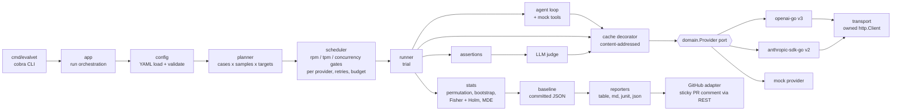
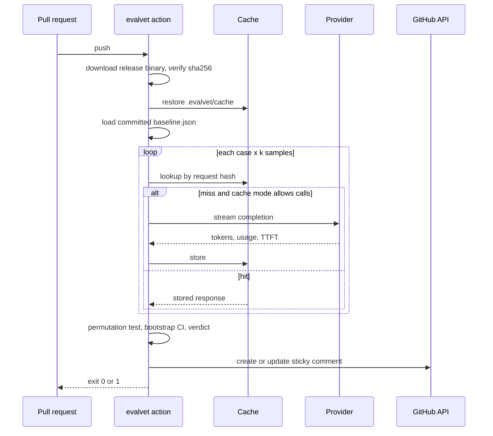

# evalvet

**Regression tests for prompts and agents, with p-values, not vibes. One Go binary, CI-native.**

evalvet samples every test case several times, compares the result with a committed baseline using a paired permutation test and a bootstrap confidence interval, and fails your pull request only when a drop is both statistically and practically significant.

[](https://github.com/Guilherme-Ciano/evalvet/actions/workflows/ci.yml)
[](https://pkg.go.dev/github.com/Guilherme-Ciano/evalvet)
[](LICENSE)
[](https://github.com/Guilherme-Ciano/evalvet/releases)

## Why

- **One sample is a coin flip.** LLM output is not deterministic, so a fixed threshold such as "pass rate at least 0.9" on a single run makes the same commit pass and fail. evalvet samples each case k times and treats the case, not the trial, as the unit of analysis.
- **You can no longer pin the randomness.** Reported: since API version 2026-10-21 the Anthropic API rejects `temperature`, `top_p` and `top_k` (pending confirmation against the official changelog). Consistent with that, `MessageNewParams` in anthropic-sdk-go v2.9.0 has no `Temperature` field (verified in source). Reasoning models behave similarly, so "set temperature to 0" is not a strategy.
- **Model swaps need evidence, not a feeling.** "Can we move this prompt to a cheaper model?" is a non-inferiority question. evalvet answers it with a confidence interval, a cost delta and a latency delta in one PR comment.

## Architecture



One CI run, baseline against head:



## Features

- **The case is the unit, not the trial.** Trials within a case are correlated, so the gate runs a one-sided paired sign-flip permutation test on per-case deltas (exact for N up to 20, otherwise 10,000 rounds with a fixed seed) and a case-clustered bootstrap for the 95% CI. See [ADR 0001](docs/adr/0001-statistics-as-the-gate.md).
- **Statistics written in-house, no runtime dependency.** Wilson, Fisher via log-gamma, seeded `math/rand/v2` PCG bootstrap, permutation, Holm and power live in `internal/stats` and are tested against reference values.
- **Official SDKs behind a port.** `openai-go/v3` and `anthropic-sdk-go/v2` sit behind `domain.Provider`. SDK retries are off; retries live in the scheduler gate so rate limiters and the budget see every attempt. See [ADR 0002](docs/adr/0002-official-sdks-behind-a-port.md).
- **Per-provider gates.** RPM, TPM and concurrency limits, `retry-after` honoured, and a hard `--budget-usd` cap that exits 4.
- **Always streams.** TTFT is the first content-bearing delta, not `message_start`, and TTFB comes from `httptrace`.
- **Content-addressed cache.** SHA-256 of canonical JSON of the provider-neutral request plus sample index, so raising k from 3 to 5 reuses 3 entries and unchanged cases cost $0. Modes `rw`, `ro`, `replay`, `refresh`, `off`. See [ADR 0003](docs/adr/0003-content-addressed-cache.md).
- **Agent evaluation without live tools.** Tools are mocked in the suite (static, matched, sequenced or erroring) and assertions check the trajectory: which tools, in which order, how many steps.
- **Honest about small samples.** When the interval straddles the margin the verdict is `INCONCLUSIVE` and the report prints the minimum detectable effect instead of silently passing.
- **No code comments, no `//go:embed`.** Enforced by a stdlib-only linter in CI. Rationale lives in [ADR 0004](docs/adr/0004-no-comments-and-no-embed.md).

## Quickstart

No API keys needed. The demo runs an invoice-extraction suite and a refund agent against a Go mock provider that serves OpenAI- and Anthropic-shaped SSE, with the baseline recorded from a good model and the head run against a seeded regression.

With Docker (exits 1 on the seeded regression, verified on 2026-11-12):

```bash
git clone https://github.com/Guilherme-Ciano/evalvet
cd evalvet
docker compose up --build --abort-on-container-exit --exit-code-from evalvet
```

Without Docker:

```bash
make build && go run ./bench/cmd/demo
```

Output, last lines:

```text
pass rate 0.98 → 0.76 (Δ −0.22, 95% CI [−0.34, −0.12]), p=<0.001, N=50 cases × k=3 · REGRESSION
cost $0.06 → $0.06 (+4%) · p50 latency 35ms → 42ms · TTFT p50 24ms → 33ms
```

Mock prices are synthetic, so the cost line demonstrates the report, not real spend.

Start your own suite, still offline:

```bash
evalvet init --template agent
evalvet run evals/agent.eval.yaml
```

Install a release binary from the [releases page](https://github.com/Guilherme-Ciano/evalvet/releases), or:

```bash
go install github.com/Guilherme-Ciano/evalvet/cmd/evalvet@latest
```

## How the gate decides

1. Each case runs k times; its pass rate is the mean of its trials.
2. The delta per case against the baseline feeds a one-sided paired sign-flip permutation test (exact for N up to 20, otherwise 10,000 seeded rounds) and a case-clustered bootstrap 95% CI.
3. `REGRESSION` only if p < α and Δ < −δ (defaults α = 0.05, δ = 0.03). A significant but tiny drop does not fail the build.
4. `INCONCLUSIVE` when the CI straddles −δ. The gate passes and the report prints the minimum detectable effect and what a bigger k would buy.
5. Non-inferiority mode (`mode: noninferiority`, `margin`) passes only when the CI lower bound is above −margin. This is the model-swap question.
6. Per-case one-sided Fisher exact tests with Holm correction and Wilson intervals explain which cases drove a regression. They do not gate.
7. If the share of trials that errored (timeouts, 5xx, auth) exceeds `gates.max_error_rate` (default 0.2), the run exits 3 instead of reporting a verdict on bad data.

| Exit code | Meaning |
|---|---|
| 0 | pass, or inconclusive |
| 1 | regression, or a non-inferiority or absolute gate failed |
| 2 | usage or configuration error, baseline not found |
| 3 | infrastructure error: auth, provider failure, cache miss under `replay`, error rate above `max_error_rate` |
| 4 | budget exceeded (`--budget-usd`) |
| 130 | interrupted |

## Configuration

A compact suite (`version`, `suite`, `providers`, `targets`, `prompts`, `tests`, `matrix`, `gates`; `tools`, `compare` and `defaults` are optional):

```yaml
version: 1
suite: refund-agent

defaults:
  samples: 5
  timeout: 60s
  judge:
    target: judge

providers:
  anthropic:
    kind: anthropic
    api_key_env: ANTHROPIC_API_KEY
    limits: { rpm: 50, tpm: 200000, concurrency: 8 }

targets:
  assistant:
    provider: anthropic
    model: claude-sonnet-5-5
    params: { max_tokens: 1024 }
  judge:
    provider: anthropic
    model: claude-haiku-5-5
    params: { max_tokens: 512 }

prompts:
  agent_system: file://prompts/support_agent.md

tools:
  lookup_order:
    description: Fetch an order by id
    parameters: file://schemas/order.json
    mock:
      static: { status: delivered, total: 129.90, currency: EUR }

tests:
  - id: refund
    system: agent_system
    each: file://fixtures/orders.jsonl
    turns:
      - user: "{{ .message }}"
    agent: { tools: [lookup_order], max_steps: 6 }
    assert:
      - kind: tool_called
        name: lookup_order
      - kind: max_tool_calls
        value: 4
      - kind: judge
        rubric:
          - id: confirms_refund
            pass: The reply confirms the refund was queued.

matrix:
  targets: [assistant]

gates:
  baseline: .evalvet/baselines/refund-agent.json
  alpha: 0.05
  min_effect: 0.03
  max_error_rate: 0.2
```

Provider kinds: `openai`, `openai_compatible` (Ollama, vLLM, OpenRouter), `anthropic`, `mock`. API keys are read only from the variable named by `api_key_env`; `evalvet validate` rejects inline keys. Environment references such as `${MOCK_URL:-http://127.0.0.1:8080}` are expanded.

Compare two targets in one run with `compare`:

```yaml
compare:
  - base: sonnet
    head: haiku
    mode: noninferiority
    margin: 0.03
```

### Assertion kinds in v0.1

| Kind | Checks |
|---|---|
| `equals` | output equals `value` |
| `contains` | output contains `value` (list with `any`, optional `case_insensitive`) |
| `regex` | output matches `pattern` |
| `json_valid` | output parses as JSON |
| `json_schema` | output validates against `schema` |
| `json_path` | value at `path` equals `equals`, matches `regex`, or `exists` |
| `not` | negates the nested assertion |
| `cost_max` | trial cost at most `max_usd` |
| `latency_max` | trial latency at most `max_ms` |
| `not_refused` | the model did not refuse |
| `tool_called` | tool `name` was called, optionally with `args` and `times` |
| `tool_not_called` | tool `name` was never called |
| `tool_order` | tools appear in `sequence` (`strict` for exact) |
| `max_steps` | agent finished within `value` steps |
| `max_tool_calls` | at most `value` tool calls |
| `judge` | LLM judge scores a `rubric` of pass/fail criteria, with its own `target` and `samples` |

### Commands

| Command | Purpose |
|---|---|
| `evalvet init` | scaffold a suite that runs offline (`--template basic\|agent\|extraction`, `--workflow`, `--dir`, `--force`) |
| `evalvet validate` | check suites without calling any model |
| `evalvet run` | run, compare with the baseline and gate |
| `evalvet compare` | compare an existing `results.json` with a baseline (`--mode`, `--margin`) |
| `evalvet baseline save\|show` | turn a `results.json` into a baseline, or print one |
| `evalvet report` | render results as `md`, `table`, `junit`, `json`, or post the sticky PR comment (`--github-comment`, `--step-summary`, `--annotations`) |
| `evalvet pricing show` | print the effective pricing table (`--pricing` layers your own YAML) |
| `evalvet version` | print the version |

Key `run` flags:

| Flag | Meaning |
|---|---|
| `--targets` | targets to run, default is the suite matrix |
| `--filter` | glob over test or case ids |
| `--samples` | override k |
| `--budget-usd` | hard spend cap, exit 4 when exceeded |
| `--cache` | `rw`, `ro`, `replay`, `refresh` or `off` (default `rw`, `ro` with `--ci`) |
| `--cache-dir` | cache location, default `.evalvet/cache` |
| `--baseline`, `--no-baseline` | choose or skip the baseline |
| `--save-baseline` | write this run as the new baseline |
| `--ci` | read-only cache; JUnit, Markdown and JSON in `--out`; step summary; annotations |
| `--format` | stdout formats: `table`, `json`, `md`, `junit` |
| `--out` | directory for `results.json`, `report.md`, `junit.xml` |
| `--seed` | seed for permutation and bootstrap, default derived from the suite hash |
| `--strict-pricing` | fail when a target has no price |
| `--keep-trajectories` | keep agent trajectories in `results.json` |
| `--max-retries` | retries on 429 and 5xx, default 4 |

## GitHub Action

A composite action. A few lines of bash (and pwsh on Windows) download the release binary and verify its sha256 against `checksums.txt`; everything else, including the PR comment, is Go. The content-addressed cache is persisted with `actions/cache`. The comment is a single sticky comment, created or updated through the REST API by `evalvet report --github-comment`. Pull requests from forks have no secrets, so they run with `--cache replay` against cached outputs and a miss exits 3.

```yaml
name: evals
on:
  pull_request:
    paths: ["evals/**", "prompts/**"]
permissions:
  contents: read
  pull-requests: write
jobs:
  evalvet:
    runs-on: ubuntu-latest
    steps:
      - uses: actions/checkout@3d3c42e5aac5ba805825da76410c181273ba90b1 # v7.0.1
      - id: evalvet
        uses: Guilherme-Ciano/evalvet@v0
        with:
          suites: evals/*.eval.yaml
          args: --budget-usd 2
        env:
          ANTHROPIC_API_KEY: ${{ secrets.ANTHROPIC_API_KEY }}
          OPENAI_API_KEY: ${{ secrets.OPENAI_API_KEY }}
      - if: always()
        uses: actions/upload-artifact@cf430e030ddbb5b0abf93d22962f4752f3646cd9 # v7.0.2
        with:
          name: evalvet-report
          path: .evalvet/out
```

Inputs: `version`, `suites`, `args`, `cache`, `comment`, `github-token`. Outputs: `verdict` (`pass`, `regression`, `error`) and `report-path`. A second workflow, [`examples/workflows/evalvet-baseline.yml`](examples/workflows/evalvet-baseline.yml), refreshes the baseline.

## Benchmarks

<!-- bench:start -->
Hardware: AMD Ryzen 5 4600G (6C/12T), 15.5 GiB RAM, Linux 7.3.3, go1.27.1, GOMAXPROCS=12. Same-host loopback, mock upstream, CPU governor not pinned (powersave, boost on), background load present (load average 5.66 at start), working tree dirty. Run-to-run variance of several percent is expected. Run 2026-11-12 at commit `0850173`.

| Benchmark | Result | Target | Verdict |
|---|---|---|---|
| Orchestration throughput (10,000 cases x 1, in-process mock, cache off) | 99,831 trials/s median (min 91,229, max 120,686; 7 runs); 30,659 trials/s including YAML load | at least 20,000 trials/s | met |
| Overhead per trial (`BenchmarkTrial`) | 73.5 µs/op, 25.8 KB/op, 370 allocs/op (median of 10) | under 50 µs and under 20 KB | **NOT MET** |
| Stats cost (bootstrap 10k x 500) | 23.3 ms/op (median of 10) | under 200 ms | met |
| Realistic concurrency (HTTP mock 300 ± 100 ms, rpm 600, concurrency 32, 150 trials) | steady state 10.00 req/s = 100.0% of the 10 req/s ceiling; wall 14.27 s vs ideal 14.30 s (5 runs) | within 2% of ceiling | met |
| Cache rerun (1,000 cases, fully cached, CLI wall) | 111 ms median (max 120 ms), 1000/1000 hits, $0, warm page cache | under 1 s | met |
| Peak RSS, 100,000 trials (20,000 cases x 5) | CLI 783 MB max (median 749); in-process VmHWM 722 MB max (median 692) | under 150 MB | **NOT MET** |
| Cold start (`evalvet version`) | 8.80 ms median (p90 12.47, max 20.37; 200 runs) | under 15 ms | met |

Two targets are not met. Per-trial overhead is about 47% over its CPU target and about 29% over its allocation target, and memory is roughly five times the target because results are held in memory and written once as `results.json`; streaming trials to JSONL is on the v0.3 roadmap. The concurrency scenario measures limiter fidelity on loopback, not internet latency.
<!-- bench:end -->

Methodology and caveats: [`bench/README.md`](bench/README.md). Full report: [`bench/results/2026-11-12-ryzen5-4600g-0850173/report.md`](bench/results/2026-11-12-ryzen5-4600g-0850173/report.md). Reproduce:

```bash
make build
go test -run='^$' -bench=. -benchmem -count=10 ./bench/... ./internal/stats/ > bench/results/raw/<sha>.txt
go run ./bench/cmd/harness -micro bench/results/raw/<sha>.txt
```

## Real-model demo

**Can we move invoice extraction from Sonnet 5.5 to Haiku 5.5?** The suite is wired in [`examples/invoice-swap/invoice.eval.yaml`](examples/invoice-swap/invoice.eval.yaml): 50 invoices, k=5, non-inferiority margin of 3 points, with GPT-5 mini as a cross-vendor reference point.

```bash
evalvet run examples/invoice-swap/invoice.eval.yaml --budget-usd 5
```

Status: not run yet, pending API budget (estimated at most $5 under the cap). No results are published here until it has run; the raw `results.json` and cache will be committed so anyone can reproduce it for free with `--cache replay`.

## Design decisions and trade-offs

- **Gate on statistics, not thresholds.** Costs k samples per case. The cache makes unchanged cases free on reruns, and small suites report their MDE instead of passing silently.
- **Per-case diagnostics do not gate.** Holm-adjusted Fisher tests explain a regression but a gate built on many per-case tests would be noisy.
- **Official SDKs, owned HTTP client and retries.** More plumbing than a thin REST client, but typed errors and streaming come from the vendor and rate limiting stays correct.
- **Chat Completions for native OpenAI in v0.1.** One code path serves OpenAI and compatible servers; the Responses API is a v0.2 candidate.
- **Results in memory.** Simple and fast, but memory grows with trial count (see the NOT MET row above).
- **Everything in Go, no code comments.** The mock provider, demo tooling and PR poster are Go; the only shell is the installer.

## Non-goals

Red-teaming and jailbreak scanning, RAG-specific metrics, a hosted UI, and dataset management. evalvet is a regression gate for CI, not an observability platform.

## Roadmap

- [x] v0.1: OpenAI, OpenAI-compatible and Anthropic providers; mock provider and mock tools
- [x] v0.1: agent loop with trajectory assertions; LLM judge
- [x] v0.1: permutation gate, bootstrap CI, non-inferiority, Holm-adjusted per-case diagnostics, MDE
- [x] v0.1: content-addressed cache with replay mode; budget cap; per-provider rate limits
- [x] v0.1: table, Markdown, JUnit and JSON reporters; GitHub Action with sticky PR comment
- [ ] v0.2: Gemini provider, adaptive sampling, `similar` assertion with embeddings
- [ ] v0.2: pairwise judge with position swap, `judge calibrate`, exec plugins
- [ ] v0.2: HTML report, OpenAI Responses API
- [ ] v0.3: MCP tools, WASM plugins, against-ref baselines
- [ ] v0.3: stream trials to JSONL to cut memory

## Verify releases

`checksums.txt` is signed with cosign keyless signing and the bundle is attached to each release.

```bash
cosign verify-blob checksums.txt \
  --bundle checksums.txt.sigstore.json \
  --certificate-identity-regexp 'https://github.com/Guilherme-Ciano/evalvet/\.github/workflows/release\.yml@.*' \
  --certificate-oidc-issuer https://token.actions.githubusercontent.com
sha256sum --check --ignore-missing checksums.txt
```

Container images at `ghcr.io/guilherme-ciano/evalvet` are signed with cosign as well.

## Contributing

See [CONTRIBUTING.md](CONTRIBUTING.md): Go 1.27, `make lint test build`, Conventional Commits with DCO sign-off, no real API spend in tests. Report vulnerabilities as described in [SECURITY.md](SECURITY.md).

## License

Apache-2.0, see [LICENSE](LICENSE).

Built by [Guilherme Ciano](https://github.com/Guilherme-Ciano).
